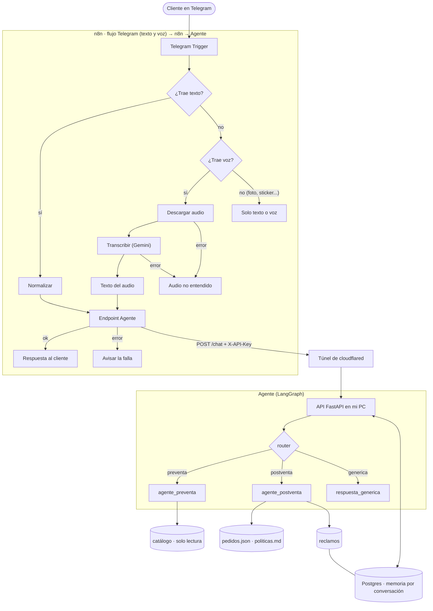

# n8n, Postgres y agentes · la entrada, la memoria y los especialistas

> **Taller de práctica personal de Alex.** No es evaluado, no se une a `main` y no lleva PR.
> Vive en la rama `alex/curso02-taller-n8n` y no afecta a los demás talleres ni a mis compañeros.

## Qué hace

Un **agente router** (LangGraph + Gemini) recibe el mensaje de un cliente de una tienda online y decide a qué agente va:

| Ruta | Cuándo | Nodo |
|---|---|---|
| `preventa` | intención de compra, productos, precios, tallas, stock, promociones, pago antes de comprar | `agente_preventa` |
| `postventa` | queja, reclamo, seguimiento, devolución, cambio, garantía, producto dañado | `agente_postventa` |
| `generica` | nada que ver con la tienda, o saludos sin pedido | `respuesta_generica` |

Si duda entre preventa y postventa, gana postventa cuando el cliente habla de algo que **ya compró**.
`agente_preventa` es un agente ReAct que atiende a quien quiere comprar consultando el catálogo real (ver
"Agente de preventa y catálogo"). `agente_postventa` también es un agente ReAct: atiende a quien ya compró (ver
"Agente de postventa").
El router decide mirando también los últimos 4 mensajes del hilo y la ruta anterior, así que una respuesta corta
("sí", "Samsung", "hasta 300 mil") sigue en la ruta en que venía la conversación.
`respuesta_generica` sí usa el modelo (sin herramientas): conversa con el historial del hilo y con la ficha de la
tienda en `data/tienda.md`, responde en máximo 3 líneas y no se sale de su papel. Si el modelo falla, devuelve una
frase fija en vez de un error.
La memoria es por `thread_id` y se guarda en Postgres (o en RAM si no hay base): ver "Memoria en Postgres".

Una **API FastAPI** expone el router en `POST /chat`. Telegram no se conecta directo: entrará por n8n, que llamará a esta API.

```
curso02-taller-n8n/
├── main.py                  # CLI
├── api/app.py               # API FastAPI
├── src/config.py            # .env y creación del modelo
├── src/memoria.py           # memoria: Postgres (esquema propio) o RAM
├── src/router/catalogo.py   # consultas de SOLO LECTURA a catalogo.productos_unicos
├── src/router/reclamos.py   # reclamos de postventa: Postgres (esquema propio) o memoria
├── data/                    # tienda.md (ruta genérica), pedidos.json y politicas.md (postventa)
├── src/router/              # graph.py · prompts.py · tools.py
├── scripts/test_router.py   # tabla de evaluación del router
├── scripts/tunel.sh         # levanta la API y el túnel de Cloudflare
├── scripts/probar_tunel.py  # prueba la API a través del túnel
├── scripts/webhook_info.py  # estado del webhook del bot de Telegram
├── scripts/ver_memoria.py   # mira los hilos guardados en Postgres
├── scripts/ver_catalogo.py  # mira el catálogo (conteo por categoría o búsqueda)
├── scripts/ver_reclamos.py  # lista los reclamos guardados
├── tests/                   # pytest (casos_router.json, test_router.py, test_api.py)
├── bruno/                   # colección de Bruno (entornos local y nube)
├── n8n/                     # flujo de n8n exportado y limpio (sin credenciales)
└── AGENTS.md                # reglas del proyecto
```

## Preparar el entorno

```bash
cd curso02-taller-n8n
python3.12 -m venv .venv
source .venv/bin/activate
pip install -r requirements.txt
cp .env.example .env          # y rellena GOOGLE_API_KEY
```

## Correr el router

```bash
python main.py router "¿tienen la polera azul en talla M?"
python main.py router "mi pedido 4521 llegó roto" --saltos    # muestra los nodos recorridos
python main.py router "y en talla L?" --hilo ana               # elige el thread_id (conversación)
python main.py router --diagrama                               # imprime el Mermaid (router y agentes de preventa y postventa) sin ejecutar
```

## Levantar la API

```bash
uvicorn api.app:app --reload --port 8000
```

- Swagger: http://localhost:8000/docs (usa el botón **Authorize** 🔒 para poner la clave y probar `/chat`)
- `GET /health` → `{"ok": true, "modelo": "...", "memoria": "ram" | "postgres"}` (abierto)
- `POST /chat` con la cabecera `X-API-Key` y `{"user_id", "texto"}` → `{"ruta", "motivo", "respuesta"}`
  (401 sin clave o con clave incorrecta, 422 si el body es inválido, 502 si falla el modelo)

Ejemplo (lee la clave desde `.env` para no escribirla a mano):

```bash
curl -s -X POST http://localhost:8000/chat \
  -H "Content-Type: application/json" \
  -H "X-API-Key: $(grep '^API_KEY=' .env | cut -d= -f2-)" \
  -d '{"user_id": "cliente-123", "texto": "¿tienen la polera azul en talla M?"}'
```

En Bruno, abre la carpeta `bruno/` como colección y elige el entorno `local` o `nube`. La URL base está en la
variable `baseUrl` y la clave en `apiKey`. Los archivos traen un texto de ejemplo: pon tu clave real desde la
app de Bruno marcando `apiKey` como **Secret** (así no queda escrita en `bruno/environments/*.bru`) y no subas
la clave real al repo.

## Clave de la API

`POST /chat` está protegido: sin la cabecera `X-API-Key` correcta responde **401**, para que nadie que conozca la
URL pueda usar el agente y gastar la cuota del modelo. Si el servidor no tiene `API_KEY` configurada, `/chat`
rechaza **todas** las peticiones (no queda abierto) y lo deja anotado en el log.

1. **Generar una clave** (dentro de `curso02-taller-n8n/` con el `.venv` activo):

   ```bash
   python -c "import secrets; print(secrets.token_urlsafe(32))"
   ```

2. **En local:** ponla en `.env` como `API_KEY=<tu-clave>`. `.env` está en el `.gitignore` y no se sube.
   `.env.example` solo trae un valor ficticio.

3. **En la nube:** créala como **variable de entorno del servidor** (`API_KEY`) en el panel del servicio donde
   despliegues. No va en el código ni en el repo.

Quien llame a `/chat` (n8n, Bruno, curl) debe mandar la cabecera `X-API-Key: <tu-clave>`.

## Agente de preventa y catálogo

`agente_preventa` (`create_agent` de LangChain, ciclo modelo ↔ herramientas) recibe el historial del hilo y consulta
el catálogo real: la tabla `catalogo.productos_unicos` de la misma base Postgres de la memoria (`DATABASE_URL`).
Sus tres herramientas están en `src/router/tools.py` y su prompt en `src/router/prompts.py`:

| Herramienta | Qué hace |
|---|---|
| `buscar_productos(consulta, categoria?, marca?, precio_max?)` | cada palabra de la consulta debe estar en el nombre; hasta 5, de mejor rating |
| `ver_producto(sku_id)` | todo el detalle de un producto, con su link |
| `mejores_ofertas(categoria?, limite=5)` | los de mayor `descuento_pct` |

El nombre, el precio, el descuento y el rating salen siempre de una herramienta. El catálogo no trae stock, colores
ni costo de envío, y el agente lo dice. Si la base no responde, la herramienta devuelve "catálogo no disponible" y el
agente lo informa: la API no se cae. En la memoria del hilo solo quedan el mensaje del cliente y la respuesta final
(no las llamadas a herramientas).

**El catálogo se consulta solo en lectura**, porque el usuario de la base puede escribir en `catalogo`:

- `catalogo.consultar()` rechaza todo lo que no sea un `SELECT` simple sobre `catalogo.productos_unicos` (una sola
  sentencia, sin comentarios, sin literales de texto, sin funciones fuera de una lista corta).
- Siempre con parámetros (`%s`): lo que escribe el cliente o el modelo nunca entra al SQL.
- La conexión es de solo lectura (`BEGIN READ ONLY`), se abre para cada consulta y se cierra al terminar.
- Como máximo 1 conexión a la vez; con el pool de la memoria (hasta 2) nunca pasa de 3.

`python main.py router "..." --saltos` muestra el recorrido, por ejemplo
`router → agente_preventa → buscar_productos → ver_producto`.

Ver el catálogo (una conexión corta, solo lectura):

```bash
python scripts/ver_catalogo.py              # cuántos productos hay por categoría
python scripts/ver_catalogo.py "samsung 55"  # hasta 10 productos cuyo nombre contiene el texto
```

## Agente de postventa

`agente_postventa` (también `create_agent`, ciclo modelo ↔ herramientas) recibe el historial del hilo y atiende a quien
ya compró. Sus tres herramientas están en `src/router/tools.py` y su prompt en `src/router/prompts.py`:

| Herramienta | Qué hace |
|---|---|
| `estado_pedido(numero)` | el pedido de `data/pedidos.json` (estado, fechas, seguimiento) o `"no existe"` |
| `politica(tema)` | la sección de `data/politicas.md`: `devoluciones`, `cambios` o `garantia` |
| `crear_reclamo(numero_pedido, motivo, detalle)` | guarda el reclamo y devuelve su ticket (`R-0001`, `R-0002`...) |

Los 8 pedidos de `data/pedidos.json` son inventados (por ejemplo, el 4521 está despachado y el 4530 entregado; el 9999
no existe). `estado_pedido` agrega `dias_desde_la_entrega` a los pedidos entregados, porque el agente no sabe qué día
es hoy y lo necesita para aplicar el plazo de 30 días.

El agente pide el número de pedido si no lo tiene, saca estados, fechas y políticas siempre de una herramienta, y antes de
crear un reclamo confirma el motivo con el cliente. Si el cliente pide hablar con una persona, o su caso no cabe en las
políticas, crea el reclamo con motivo `derivar a persona`. El `thread_id` del reclamo lo toma de la configuración del
grafo: el modelo no lo ve ni lo puede fijar.

**Dónde se guardan los reclamos:** en la tabla `reclamos` de Postgres, en el esquema propio (`DB_SCHEMA`, por defecto
`alex_nail`; nunca `public`, `catalogo` ni `alumnoNN`). Se crea al arrancar si no existe, usa el pool de la memoria (no abre
conexiones nuevas: con el catálogo, nunca más de 3 en total) y el número de ticket lo genera la base (`serial`). Las
consultas llevan siempre parámetros. Sin Postgres, los reclamos se guardan en memoria (se pierden al reiniciar) y se
avisa en el log, sin la URL. Si la base falla justo al crear uno, el agente lo dice y no inventa un ticket.

```bash
python scripts/ver_reclamos.py        # los últimos 20 reclamos (una conexión corta, solo lectura)
python scripts/ver_reclamos.py 50
```

## Memoria en Postgres

El agente recuerda la conversación por `thread_id` (en la API, el `user_id`). Con `DATABASE_URL` en `.env`, esa
memoria se guarda en **Postgres** (checkpointer `PostgresSaver` de LangGraph) y **sobrevive a un reinicio**.
La API y `main.py` usan la misma memoria, así que una conversación empezada en la terminal sigue en la API.

- **Esquema propio:** la base es compartida por todo el curso, así que las tablas (`checkpoints`,
  `checkpoint_blobs`, `checkpoint_writes`, `checkpoint_migrations`) se crean solo en el esquema de `DB_SCHEMA`
  (por defecto `alex_nail`). Se crea con `CREATE SCHEMA IF NOT EXISTS` al arrancar y cada conexión se fija a
  ese esquema con `search_path`. Se rechazan `public`, `catalogo`, `alumnoNN` y `pg_*`.
- **Pocas conexiones:** un pool de 1 a 2 conexiones, abierto una vez al arrancar la API y cerrado al apagarla, que
  comprueba cada conexión antes de usarla. `main.py` abre su conexión y la cierra al terminar.
- **Sin base, sigue funcionando:** si falta `DATABASE_URL`, o Postgres no responde al arrancar (incluido
  "remaining connection slots are reserved"), se usa **RAM** (`MemorySaver`), se anota el motivo en el log y la API
  no se cae. La memoria en RAM se pierde al reiniciar. `GET /health` dice cuál se está usando.
- **Secretos:** la URL, la clave y la dirección del servidor no se imprimen ni se registran: los errores y los
  logs de la conexión se limpian antes de mostrarse.

Ver qué hay guardado:

```bash
python scripts/ver_memoria.py              # hilos guardados: cuántos checkpoints tiene cada uno y el último
python scripts/ver_memoria.py prueba1      # los mensajes de ese hilo, en orden
```

Una sola conexión corta y en solo lectura.

## Túnel para n8n

Para que n8n pueda llamar a la API de este PC, se expone con un **túnel rápido de Cloudflare**
(`cloudflared`, modo *quick tunnel*, sin cuenta).

1. **Levantarlo** (desde `curso02-taller-n8n/`; el script activa el `.venv` solo):

   ```bash
   ./scripts/tunel.sh
   ```

   Levanta la API en el puerto 8000, espera a que `/health` responda, abre el túnel e imprime algo así:

   ```
   URL pública :  https://palabras-al-azar.trycloudflare.com
   Para n8n    :  https://palabras-al-azar.trycloudflare.com/chat
   ```

   Deja esa terminal abierta: ahí se ven las peticiones que llegan. **Ctrl+C** apaga la API y el túnel.

2. **Probarlo** (en otra terminal, con el `.venv` activo):

   ```bash
   python scripts/probar_tunel.py https://palabras-al-azar.trycloudflare.com
   ```

   Hace 3 pruebas: `GET /health` → 200, `POST /chat` sin clave → 401 y `POST /chat` con la clave de `.env` → 200.
   La clave se lee de `.env` y nunca se imprime.

3. **En n8n**, en el nodo **Endpoint Agente** (HTTP Request): método `POST`, URL `…trycloudflare.com/chat`,
   cabecera `X-API-Key` con tu clave y body `{"user_id", "texto"}`.

Ten en cuenta:

- **La URL cambia cada vez que se reinicia el túnel.** Después de cada `./scripts/tunel.sh` hay que copiar la
  nueva URL en el nodo **Endpoint Agente** de n8n.
- **Solo funciona mientras el PC y el script estén corriendo.** Si apagas el PC, cierras la terminal o haces
  Ctrl+C, n8n deja de poder llamar a `/chat`.
- El túnel es público: cualquiera con la URL puede llegar a la API. Por eso `/chat` exige la `X-API-Key`.

## n8n: la puerta de entrada

### 1. El recorrido

Telegram no habla directo con la API: entra por **n8n**, que decide qué hacer con cada mensaje y llama a `POST /chat`.
La API corre en mi PC y se expone a internet con el túnel de `cloudflared`.



En palabras:

1. El cliente escribe (o manda un audio) a mi bot de Telegram.
2. **Telegram Trigger** recibe el mensaje. **¿Trae texto?** lo manda a **Normalizar**, que arma `{"user_id", "texto"}` con el
   id del chat como `user_id`.
3. Si no trae texto, **¿Trae voz?** manda el audio a **Descargar audio** → **Transcribir** (Gemini) → **Texto del audio**,
   que arma el mismo `{"user_id", "texto"}`. Desde ahí, voz y texto siguen el mismo camino.
4. **Endpoint Agente** hace `POST /chat` con la cabecera `X-API-Key` (tiempo máximo: 30 s) a la URL del túnel.
5. La API clasifica el mensaje con el **router** y lo lleva a **preventa**, **postventa** o **genérica**. La conversación
   queda guardada en Postgres con el `user_id` como `thread_id`.
6. **Respuesta al cliente** le devuelve por Telegram el campo `respuesta` del JSON.

### 2. Cómo reproducirlo

1. **Levantar la API y el túnel** (desde `curso02-taller-n8n/`):

   ```bash
   ./scripts/tunel.sh
   ```

   Copia la URL que imprime junto a "Para n8n" (termina en `/chat`).

2. **Importar el flujo** `n8n/flujo_telegram_agente.json` en un n8n propio (autoalojado o cloud): *Workflows → ⋯ →
   Import from file*. Si es autoalojado, debe ser accesible por HTTPS desde internet para que Telegram le entregue los
   mensajes.

3. **Crear las tres credenciales** y elegirlas en los nodos (el export no las trae):

   | Credencial en n8n | Qué lleva | Dónde se usa |
   |---|---|---|
   | **Telegram API** | el token de un **bot propio** (@BotFather) | Telegram Trigger y los nodos de Telegram (Respuesta al cliente, Avisar la falla, Solo texto o voz, Descargar audio, Audio no entendido) |
   | **Header Auth** | Name: `X-API-Key`; Value: la `API_KEY` de la API | Endpoint Agente |
   | **Google Gemini (PaLM) API** | la clave del modelo | Transcribir |

4. **Poner la URL en Endpoint Agente:** el archivo trae `https://TU-API/chat`; reemplázala por la URL del túnel terminada
   en `/chat`.

5. **Publicar el flujo.** Al activarlo, el Telegram Trigger registra el webhook del bot; se comprueba con
   `python scripts/webhook_info.py`.

> **La URL del túnel cambia cada vez que se reinicia `./scripts/tunel.sh`.** Hay que copiar la nueva en Endpoint Agente
> (y volver a publicar el flujo) o n8n llamará a una dirección que ya no existe.

### 3. Qué no está en el repositorio

- Las **credenciales de n8n** (Telegram, Header Auth, Gemini): se crean en cada n8n.
- La **clave de la API** (`API_KEY`), el **token del bot** (`TELEGRAM_TOKEN`), la **clave del modelo**
  (`GOOGLE_API_KEY`) y la **`DATABASE_URL`**: viven solo en `.env`, que Git ignora. `.env.example` trae valores ficticios.
- El flujo exportado se limpió antes de subirlo: sin `webhookId`, sin ids de instancia ni de credencial, y con la URL
  del Endpoint Agente en `https://TU-API/chat`.

### 4. Qué pasa cuando falla

| Situación | Qué pasa |
|---|---|
| Llega un **audio de voz** | n8n lo descarga, lo transcribe con Gemini y entra a la API **como texto** |
| El audio **no se puede descargar ni transcribir** | nodo **Audio no entendido**: "No pude escuchar tu audio. ¿Me lo escribes?" |
| Llega una **foto, sticker u otro tipo** de mensaje | nodo **Solo texto o voz**: "Por ahora solo leo mensajes de texto y audios de voz." |
| **API caída, túnel apagado, clave mala (401) o más de 30 s sin respuesta** | Endpoint Agente sale por su rama de error → nodo **Avisar la falla**: "Tuve un problema para responderte. Intenta de nuevo en un minuto." |
| El audio se transcribe a **texto vacío** | la API responde 422 y se cae en **Avisar la falla** |
| **Postgres no responde al arrancar la API** | la API arranca igual con la memoria y los reclamos **en RAM**, anota el motivo en el log (sin la URL) y `GET /health` devuelve `"memoria": "ram"` |
| Postgres se cae **con la API ya en marcha** | `/chat` responde 502 (→ **Avisar la falla**) hasta que la base vuelva (el pool se reconecta); no hay cambio automático a RAM |
| **El catálogo no responde** | la herramienta devuelve "catálogo no disponible" y el agente lo dice al cliente |

### 5. La memoria y los datos

- **Postgres guarda** las conversaciones (tablas `checkpoints`, `checkpoint_blobs`, `checkpoint_writes` y
  `checkpoint_migrations`) y los **reclamos** (tabla `reclamos`), todo en el esquema `DB_SCHEMA` (por defecto
  `alex_nail`), nunca en `public`, `catalogo` ni `alumnoNN`.
- El **catálogo** (`catalogo.productos_unicos`) solo se **lee**, en una conexión de solo lectura.
- El `thread_id` de cada conversación es el `user_id` que manda n8n: el id del chat de Telegram.
- **Verlo:**

  ```bash
  python scripts/ver_memoria.py                 # hilos guardados, con cuántos checkpoints y la fecha del último
  python scripts/ver_memoria.py ID_DEL_CHAT     # los mensajes de esa conversación
  python scripts/ver_reclamos.py                # los últimos reclamos, con su ticket (R-0001...)
  ```

- La `DATABASE_URL` **se pide por vía privada** (no se publica ni se sube): cada quien la pone en su `.env`.

### 6. Límites conocidos

- **La API corre en mi PC**, expuesta con un túnel, no en la nube: si el PC o el script se apagan, el agente deja de
  responder, y la URL cambia en cada reinicio. El `Procfile` y el `.python-version` ya están listos para desplegarla.
- **La `DATABASE_URL` del curso entra con un usuario con más permisos de lo debido** (puede escribir en todo). Por eso
  las tablas propias van en un esquema propio y el catálogo se consulta solo en lectura: solo se aceptan `SELECT`
  simples, con parámetros, en una conexión de solo lectura y con una conexión a la vez.
- **Cualquiera que conozca un número de pedido ve sus datos** (nombre, productos, estado, seguimiento): no hay
  verificación de identidad.
- El túnel es público: lo único que protege a `/chat` es la `X-API-Key`.
- Los **pedidos y las políticas son inventados** (`data/pedidos.json`, `data/politicas.md`), y el agente de postventa
  no ejecuta devoluciones ni cambios: solo informa y deriva con un reclamo.

## Correr las pruebas

```bash
python scripts/test_router.py   # tabla: mensaje, esperado, obtenido, ✔/✘, motivo y resumen
pytest                          # router (máximo 2 fallos, llama al modelo) + API y memoria (sin modelo ni base)
pytest tests/test_api.py tests/test_memoria.py tests/test_generica.py tests/test_catalogo.py tests/test_preventa.py tests/test_postventa.py
                                # todo lo que no usa el modelo real ni la base (modelo y catálogo falsos)
```

## Avance

Pasos del taller (la numeración sigue el orden en que se fue trabajando):

1. **Carpeta y rama propias:** `curso02-taller-n8n/` en la rama `alex/curso02-taller-n8n`, sin PR ni merge.
2. **Entorno:** Python 3.12, `.venv`, dependencias, `.env`/`.env.example` y `AGENTS.md`.
3. **Agente router:** salida estructurada (preventa, postventa o genérica), memoria por `thread_id`, y 16 casos de
   prueba (`scripts/test_router.py`).
4. **API FastAPI:** `/health` y `/chat`, Swagger completo y colección de Bruno.
5. **Clave de la API:** `/chat` exige `X-API-Key`.
6. **Túnel:** `scripts/tunel.sh` (API + cloudflared) y `scripts/probar_tunel.py`.
7. **Telegram:** bot propio y `scripts/webhook_info.py`; Telegram entra por n8n, no directo a la API.
8. **Postgres:** `scripts/probar_db.py` y memoria persistente (checkpointer) en un esquema propio, con caída a RAM.
9. **Ruta genérica:** conversa con el modelo y la ficha de la tienda (`data/tienda.md`), sin salirse de su papel.
10. **Preventa con catálogo real:** agente ReAct con `buscar_productos`, `ver_producto` y `mejores_ofertas`
    (`catalogo.productos_unicos`, solo lectura); el router mira el historial y la ruta anterior.
11. **Postventa con pedidos y reclamos:** agente ReAct con `estado_pedido`, `politica` y `crear_reclamo`; los reclamos
    se guardan en Postgres.
12. **Flujo de n8n:** Telegram (texto y voz) → n8n → Agente, con transcripción de audio y avisos de falla.
13. **Cierre:** flujo exportado y limpio en `n8n/`, revisión de secretos y este README.

**Lo que se hizo distinto a la clase**

- **n8n autoalojado.**
- **Túnel de Cloudflare en vez de Heroku:** la API corre en mi PC (`./scripts/tunel.sh`); el `Procfile` y el
  `.python-version` quedaron listos por si se despliega.
- **Esquema propio (`alex_nail`)** en la base compartida, porque la `DATABASE_URL` entra con un usuario con más permisos
  de los debidos; el catálogo se lee en solo lectura.
- **La voz se transcribe en n8n** (nodo de Gemini): a la API siempre llega texto.
