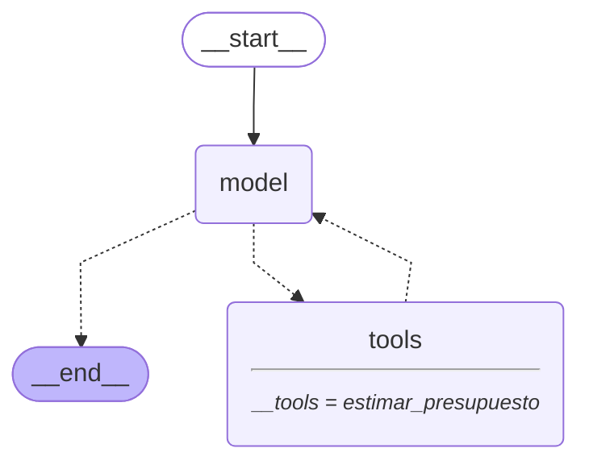

# Documento de entrega · Taller A2A · Grupo 5

**Tema del grupo:** planificador de ferias y eventos.

| Integrante | Agente |
|------------|--------|
| Matias Muñoz | Programa, actividades y horarios |
| Alex Nail | Lugares y capacidad |
| Eduardo Basaure | Presupuesto y costos estimados |
| Sebastian Mardones | Comida y catering |

> Este documento cubre el agente de **Eduardo Basaure**. La ronda de preguntas se completa
> en la prueba grupal con el coordinador y los agentes de los compañeros.

## 1. Blueprint y alcance

Versión final: [`blueprint-Eduardo.md`](blueprint-Eduardo.md).

El agente estima presupuestos agregados simulados en CLP para eventos tecnológicos,
gastronómicos, culturales e infantiles, para 10–500 personas y duraciones de 30–480 minutos.
`estimar_presupuesto` informa partidas, subtotal, contingencia del 10 % y total; usa tarifas
ficticias y no modela impuestos. No genera cotizaciones ni autoriza compras, reservas,
pagos o contrataciones.

Derivaciones: menús, comida y catering → Sebastián; recintos y capacidad → Alex; actividades
y horarios → Matías. Las consultas ajenas se rechazan en una frase, se deriva al agente
correspondiente y no se ejecuta la herramienta de presupuesto.

## 2. Construcción y cambios

La herramienta usada para esta revisión fue **OpenCode**. No se dispone de un prompt original
auténtico ni de una transcripción de la construcción inicial; no se inventa ninguno.

El cambio funcional de `src/agente_eduardo/prompts.py` refuerza la derivación por
especialidad, evita presentaciones espontáneas y prohíbe llamar a `estimar_presupuesto` para
consultas ajenas. El cambio está incluido en el PR y fue validado con ejecuciones reales.

## 3. Pruebas y diagrama

Las siguientes comprobaciones fueron validadas por Eduardo para esta sesión; no se
re-ejecutaron durante la revisión documental:

- **Pruebas automatizadas:** 70 aprobadas.
- **Presupuesto:** feria tecnológica, 80 personas, 240 minutos. Resultado total
  **$2.173.600 CLP**, en 3 saltos: `model → tools (estimar_presupuesto) → model`.
- **Derivación de menú vegetariano:** Sebastián, 1 salto (`model`), sin herramienta.
- **Derivación de consulta sobre recintos:** Alex, 1 salto (`model`), sin herramienta.
- - **Derivación de consulta sobre actividades y horarios:** Matías es el agente responsable según el prompt. Prueba de ejecución pendiente.

Diagrama Mermaid generado directamente con el comando `python main.py eduardo --diagrama`:

La captura [`evidencias/eduardo/01-saltos.png`](evidencias/eduardo/01-saltos.png) muestra la ejecución del presupuesto simulado de $2.173.600 CLP, con tres saltos y uso de `estimar_presupuesto`. También muestra el rechazo completo de una consulta sobre menú vegetariano, derivada a Sebastián en un salto y sin ejecutar herramientas. La evidencia no expone rutas personales ni credenciales.

La derivación a Alex fue verificada mediante una ejecución independiente. La derivación a Matías está definida en el prompt, pero su prueba específica continúa pendiente.

## 4. Fichas del agente: antes y después

Las dos fichas se guardaron levantando el agente en `http://127.0.0.1:8005` y leyendo
`/.well-known/agent-card.json`. Las dos anuncian `http://127.0.0.1:8005`.

**De dónde sale `02-ficha-antes.json`.** Es la ficha real que publicaba el agente en `main`
el 8 de noviembre de 2026, justo antes del ajuste descrito abajo (era la misma que estaba
guardada como `02-ficha.json`). Hasta entonces `server.py` había tenido una sola versión de
la ficha, por eso no existía una ficha «antes». Ahora sí existe una versión anterior real.

Descripción antes ([`evidencias/eduardo/02-ficha-antes.json`](evidencias/eduardo/02-ficha-antes.json)):

> Estima presupuestos agregados y simulados para ferias y eventos usando únicamente tarifas
> ficticias. No prepara menús ni cotiza catering (Sebastián), ni recomienda recintos (Alex);
> tampoco autoriza compras, reservas, pagos o contrataciones.

Descripción después ([`evidencias/eduardo/02-ficha.json`](evidencias/eduardo/02-ficha.json)):

> Estima presupuestos agregados y simulados para ferias y eventos usando únicamente tarifas
> ficticias. Incluye un costo de alimentación genérica por persona, pero no prepara menús
> (Sebastián), ni recomienda recintos (Alex); tampoco autoriza compras, reservas, pagos o
> contrataciones.

**Por qué se cambió.** Es un ajuste hecho en la revisión del grupo, después del ensayo
general del 8 de noviembre. En el ensayo, el supervisor mandó «¿Cuánto cuesta el catering
para 100 personas?» a Eduardo porque es un costo, pero su prompt la rechazaba («corresponde
a Sebastián») y Sebastián no da precios, así que nadie la respondía. Además, la ficha decía
«no cotiza catering», aunque la herramienta sí calcula una partida de alimentación genérica.

Cambios:

- Ficha: ahora dice que incluye un costo de alimentación genérica por persona, pero que no
  prepara menús.
- Prompt: se agregó «Si preguntan cuánto cuesta la comida o el catering, es una consulta de
  costos: pide los datos que falten, usa estimar_presupuesto y destaca la partida de
  alimentación genérica. Solo deriva a Sebastián cuando pidan qué menú servir.» La regla
  anterior («Si preguntan por menús, comida o catering… corresponde a Sebastián») se acotó a
  «qué menú o qué comida servir», para que no contradiga la nueva.

Resultado después del cambio:

- «¿Cuánto cuesta el catering para 100 personas?»: pregunta el tipo de evento.
- Con «feria tecnológica de 4 horas» en la misma conversación: entrega el presupuesto con
  la alimentación genérica destacada ($180.000 CLP; total $2.497.000 CLP).
- «¿Qué menú sirvo para 80 personas?»: «Eso corresponde a Sebastián.»

La ficha pública disponible en
[`evidencias/eduardo/03-ficha-telefono.png`](evidencias/eduardo/03-ficha-telefono.png)
se ve en un teléfono con 4G y contiene la URL pública en `supportedInterfaces[0].url`.
El archivo original era JPEG y se convirtió a PNG para cumplir la pauta; el original se
conserva localmente fuera del PR. Las tildes aparecen mal interpretadas por el navegador en
la captura; no se corrige la imagen.

## 5. A2A y dirección pública

La respuesta guardada [`evidencias/eduardo/04-a2a-publico.json`](evidencias/eduardo/04-a2a-publico.json)
registra el presupuesto de $2.173.600 CLP. Es una respuesta archivada y no prueba por sí
sola que un servidor continúe activo. La respuesta está en `result.message.parts[0].text`.

URL verificada en la sesión del **8 de noviembre de 2026**:
<https://breaking-rid-bestsellers-juvenile.trycloudflare.com>.
Es un túnel rápido de Cloudflare **temporal**: puede dejar de funcionar y la URL puede
cambiar al reiniciar el túnel. La captura [`evidencias/eduardo/03-tunel.png`](evidencias/eduardo/03-tunel.png)
muestra a `cloudflared` anunciando esa URL y la configuración de origen local en el puerto
8005; la captura telefónica muestra la ficha publicada con esa URL.

## 6. Evidencias disponibles y validación de archivos

- `01-saltos.png`: captura de terminal; PNG válido. Se ve la ejecución de presupuesto con
  `estimar_presupuesto` y 3 saltos; aparece también el inicio de la derivación vegetariana.
- `03-tunel.png`: captura de la terminal de Cloudflare; PNG válido. Muestra la URL temporal,
  fecha/hora de la sesión y el origen local `127.0.0.1:8005`.
- `03-ficha-telefono.png`: captura de la ficha en Safari móvil por 4G, convertida del JPEG
  original para cumplir la pauta. El original JPEG se conserva localmente fuera del PR.
- `02-ficha-antes.json` y `02-ficha.json`: ficha local antes y después del ajuste de la
  revisión del grupo (sección 4).
- `04-a2a-publico.json` y `respuesta-a2a.json`: respuestas guardadas; no equivalen a una
  repetición actual de A2A.

No se tomó la captura de `01-saltos.png` como prueba visual de todas las consultas; los
 resultados de las tres derivaciones provienen de ejecuciones reales validadas por Eduardo.

## 7. Pendientes de la prueba grupal

- Ejecutar la ronda conjunta con el coordinador y los agentes de los compañeros.
- Registrar las preguntas, agente seleccionado, resultado y análisis de derivaciones
  ambiguas en la tabla de la ronda.
- Capturar la vista del supervisor/catálogo y completar las evidencias grupales que solicite
  el taller.

## 8. Estado de Git y seguridad

Se revisaron `git status --short`, `git diff --check` y los archivos de evidencia a incorporar.
No se encontraron patrones de credenciales en los documentos y evidencias revisados. Los
archivos JSON/fotos contienen datos de demostración y la URL temporal; mantenerlos dentro
del alcance de la revisión. El cambio funcional de `src/agente_eduardo/prompts.py` está
preparado en Git junto con las evidencias correspondientes.

Los archivos del PR ya están preparados en Git. Entre las limitaciones y pendientes se
mantienen la ronda grupal aún no ejecutada y el carácter temporal de la URL pública. No se ejecutaron commit ni push ni se creó
un PR.
