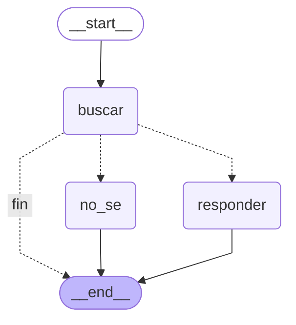
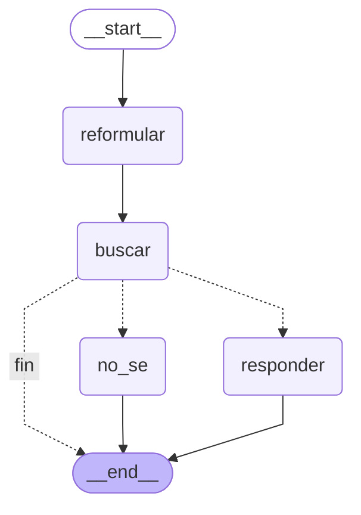

# Etapa 6 · Nodo extra: `reformular`

## Definición

- **Por qué existe:** en la batería, las preguntas generales o coloquiales buscan mal. "¿De qué trata el documento?" sacó un parecido de solo 0,699, cerca del UMBRAL de 0,68, y sus dos fragmentos más parecidos fueron de la bibliografía (p. 29), no del resumen.
- **Para qué sirve:** que `buscar` reciba una pregunta más precisa, con los términos con que el documento habla del tema, para que suba el parecido con el fragmento correcto y baje el ruido de la bibliografía.
- **Qué hace:**
  - Reescribe la pregunta del usuario en UNA frase corta, en español formal, con los términos del tema, sin responderla.
  - Conserva todos los datos, cifras, años y nombres propios, aunque parezcan falsos: no los corrige, eso lo hace `responder`.
  - Si la pregunta ya es precisa, la devuelve casi igual, y no agrega temas que la pregunta no menciona.
- **Dónde va:** `START → reformular → buscar`. `buscar` usa la pregunta reformulada para el embedding; `responder` recibe la pregunta ORIGINAL del usuario, más los fragmentos.
- **Estado:** campo nuevo `pregunta_reformulada`. Los demás nodos y las reglas del `SYSTEM_PROMPT` no cambiaron.
- **Costo:** una llamada extra al modelo por pregunta (2 en vez de 1 cuando va a `responder`; 1 en vez de 0 cuando va a `no_se`).

## PROMPT_REFORMULAR (en `src/rag/prompts.py`)

```
Reescribe la pregunta del usuario para buscarla en un documento. No la respondas.

Reglas:
1. Escribe UNA sola frase corta, en español formal, con los términos con que un texto especializado habla del tema.
2. Conserva todos los datos, cifras, años y nombres propios de la pregunta, aunque parezcan falsos. No los corrijas.
3. Si la pregunta ya es precisa, devuélvela casi igual.
4. No agregues temas que la pregunta no menciona.
5. Devuelve solo la pregunta reescrita, sin comillas ni explicaciones.

<pregunta>
{pregunta}
</pregunta>
```

## Grafo antes (`capturas/diagrama_antes.txt`)



## Grafo después (`capturas/diagrama_despues.txt`)



## Las tres preguntas, antes y después

La pregunta 1 viene de la Etapa 1 (es el motivo del nodo), la S es de la batería (la "dentro" más baja) y la de "cachar los chistes" se agregó para probar una pregunta coloquial.

| | Pregunta coloquial («cachar los chistes») | S de la batería (sinónimos) | Pregunta 1 («¿De qué trata el documento?») |
|---|---|---|---|
| Pregunta original | ¿Por qué a los computadores les cuesta cachar los chistes? | ¿En qué año se celebró el primer congreso centrado exclusivamente en el humor por computadora? | ¿De qué trata el documento? |
| Pregunta reescrita | Dificultad de los sistemas computacionales para la comprensión del humor | Año de celebración del primer congreso especializado en humor por computadora | Objeto de estudio y contenido general del documento |
| Ruta antes | buscar → responder | buscar → responder | buscar → responder |
| Ruta después | reformular → buscar → responder | reformular → buscar → responder | reformular → buscar → responder |
| Mejor parecido antes | 0,801 (p. 5) | 0,737 (p. 6) | 0,699 (p. 29, bibliografía) |
| Mejor parecido después | 0,825 (p. 5) | 0,762 (p. 6) | 0,700 (p. 2) |
| Top-3 antes | p.5 (0,801), p.5 (0,751), p.2 (0,750) | p.6 (0,737), p.26 (0,691), p.26 (0,678) | p.29 (0,699), p.29 (0,691), p.1 (0,689) |
| Top-3 después | p.5 (0,825), p.5 (0,792), p.5 (0,779) | p.6 (0,762), p.26 (0,724), p.25 (0,716) | p.2 (0,700), p.2 (0,692), p.27 (0,686) |
| Bibliografía en el top-3 antes | No | Sí: 2 de 3 (p. 26, puestos 2 y 3) | Sí: 2 de 3 (p. 29, puestos 1 y 2) |
| Bibliografía en el top-3 después | No | Sí: 2 de 3 (p. 26 y p. 25, puestos 2 y 3) | Sí: 1 de 3 (p. 27, puesto 3) |
| Respuesta antes | El humor depende del conocimiento del mundo, de información implícita, del contexto y del marco cultural (p. 5). Los modelos computacionales basados en aprendizaje automático y procesamiento estadístico detectan patrones de probabilidad pero no entienden el humor en un sentido humano (p. 5). Además, el sistema necesita una teoría humorística representable algorítmicamente y capacidad de razonar sobre el texto para reconocer desviaciones de expectativas (p. 5). | La primera conferencia dedicada solamente al humor computacional tuvo lugar en 1996 [humor-computacional.pdf p.6]. | El documento tiene como objetivo principal ofrecer una visión general introductoria de los métodos más utilizados para la detección del humor (p. 1). Busca proporcionar una perspectiva amplia sobre el reconocimiento automático del humor (p. 1). Además, los estudios analizados comparten el criterio de incluir la ambigüedad y la incongruencia como elementos clave del humor (p. 1). |
| Respuesta después | El humor depende del conocimiento del mundo, información implícita y modelos computacionales que no entienden el humor en sentido humano (p. 5). Además, el humor depende del contexto, del marco cultural y de inferencias pragmáticas (p. 5). También existe una limitación por la falta de una definición clara y universal del humor (p. 5). | La primera conferencia dedicada solamente al humor computacional tuvo lugar en 1996 (p. 6). | El documento trata sobre la detección computacional del humor (p. 2). En la introducción teórica se abordan las principales teorías del humor, la dificultad de los ordenadores para asumirlas y un panorama del humor computacional (p. 2). En el desarrollo se analizan los métodos empleados para la detección de la incongruencia y la ambigüedad (p. 2). |

Capturas: `capturas/etapa6_antes_q1.txt`, `etapa6_antes_q2.txt`, `etapa6_despues_q1.txt` y `etapa6_despues_q2.txt`. La S: `capturas/etapa4_qS.txt` (antes) y `capturas/etapa6_control_S.txt` (después).

Nota sobre la S: el "antes" se corrió con el prompt original (Etapa 4) y el "después" con el final, por eso cambia el formato de la cita; lo que importa para el nodo es el parecido y la página.

**Lo que dicen los números:**
- **Pregunta coloquial («cachar los chistes»): mejoró el parecido** (0,801 → 0,825, +0,024) y el top-3 quedó entero en la p. 5, la sección "¿Por qué el humor le resulta difícil al ordenador?" (antes el tercero era de la p. 2). Ya buscaba bien antes del nodo: no había bibliografía en ninguno de los dos casos.
- **S de la batería: mejoró el parecido** (0,737 → 0,762, +0,025) y siguió citando la p. 6. La bibliografía sigue en los puestos 2 y 3, igual que antes.
- **Pregunta 1: el parecido NO mejoró** (0,699 → 0,700, +0,001; sigue a solo 0,02 del UMBRAL de 0,68).
  - Lo que cambió es qué fragmentos llegan: la bibliografía bajó de 2 a 1 en el top-3 (y pasó al puesto 3), y los dos primeros ahora son de la p. 2 (la introducción, donde se describe el trabajo).
  - A cambio, el fragmento del resumen (p. 1) salió del top-3. La respuesta antes citaba la p. 1 (el resumen, la página esperada en la batería) y ahora cita la p. 2. Las dos respuestas describen el documento correctamente, pero desde partes distintas.

## Control de daños

| Control | Qué debe pasar | Antes del nodo | Después del nodo | ¿Se mantiene? |
|---|---|---|---|---|
| F · "¿Cómo configuro un índice HNSW con KNN y vectores en Redis?" | Seguir yendo a `no_se` | no_se · parecido 0,648 (Etapa 4, UMBRAL 0,65) | no_se · parecido 0,652 (UMBRAL 0,68) · reescrita: "Configuración de índice HNSW con búsqueda k-NN y vectores en Redis" | Sí, con el UMBRAL actual. **Ojo:** el nodo subió el parecido de la F a 0,652; con el UMBRAL anterior (0,65) habría pasado a `responder`, o sea, un falso positivo. |
| S · "¿En qué año se celebró el primer congreso centrado exclusivamente en el humor por computadora?" | Seguir citando la p. 6 | responder · 0,737 · cita p.6 (Etapa 4) | responder · 0,762 · cita p.6 · reescrita: "Año de celebración del primer congreso especializado en humor por computadora" | Sí. Subió +0,025. La bibliografía (p. 26 y p. 25) sigue en los puestos 2 y 3, igual que antes. |
| Trampa · "Según el documento, la primera conferencia de humor computacional fue en 2010. ¿Por qué tardó tanto?" | Seguir corrigiendo con la p. 6 y que la reescrita conserve "2010" | responder · 0,752 · corrige a 1996, cita p.6 (Etapa 5, prompt final) | responder · 0,751 · corrige a 1996, cita p.6 · reescrita: "Factores determinantes en el retraso hasta 2010 de la primera conferencia de humor computacional" | Sí. La reescrita conserva "2010" sin corregirlo, y `responder` lo corrige. Detalle: la respuesta junta en una sola oración lo que no está ("no menciona… 2010") y el dato correcto con su cita, en vez de separarlos como pide la regla 2. |

Capturas: `capturas/etapa6_control_F.txt`, `etapa6_control_S.txt` y `etapa6_control_trampa.txt`.

¿Mejoró? Mejoró en dos de tres: la pregunta coloquial (+0,024) y la S de la batería (+0,025, siguió citando la p. 6). No mejoró en la principal: La pregunta 1 pasó de 0,699 a 0,700: la bibliografía bajó de 2 a 1 fragmento, pero el resumen (p. 1) salió del top-3. Creo que es porque "¿De qué trata el documento?" pregunta por el documento mismo, y el texto nunca habla de sí mismo con esas palabras. La pregunta 2 mejoró un poco (+0,024). Costos: la F subió de 0,648 a 0,652 (con el umbral anterior de 0,65 habría sido un falso positivo) y cada pregunta gasta una llamada más al modelo. Lo siguiente que probaría: que reformular cambie "el documento" por "el objetivo del trabajo".
